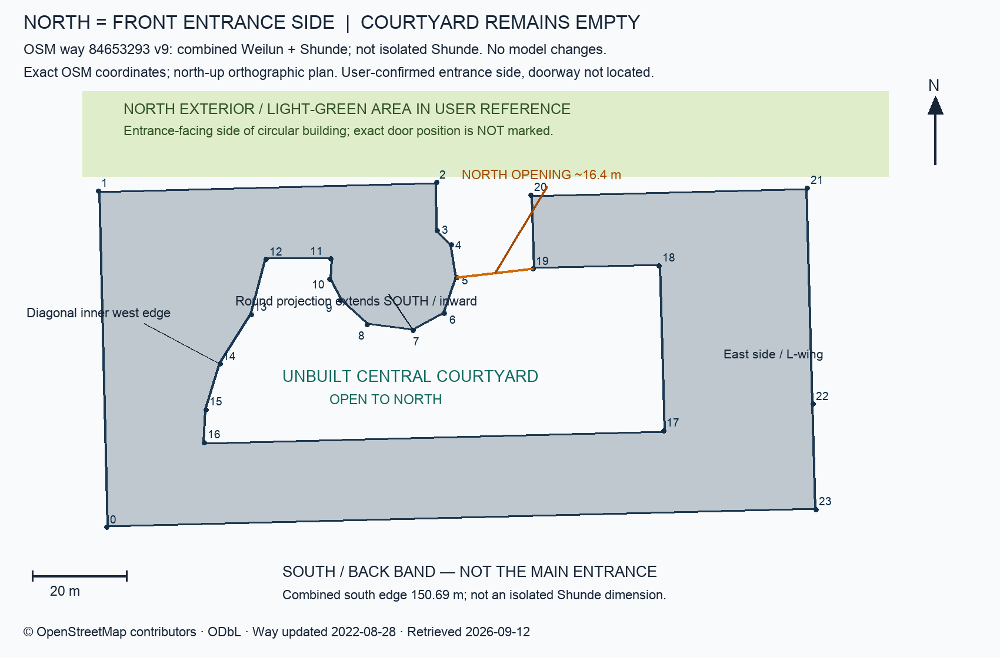
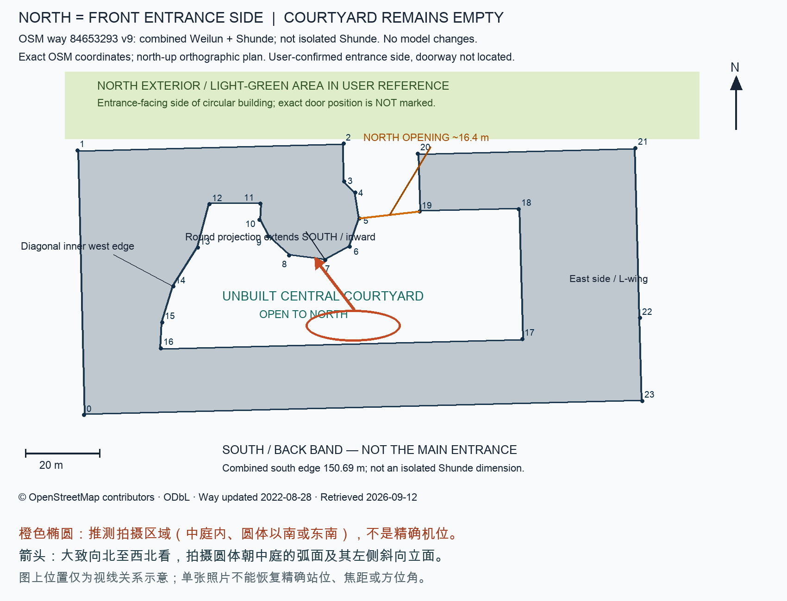

# 舜德楼：庭院结构重建依据

## 任务与版本边界

本轮在同一 `projects/shunde/` 项目中纠正旧模型的空间关系；旧版留在 Git 历史，不建立 `shunde-v2` 或 `shunde-v3`。2026-09-12，用户确认对照图与院内照片的对应关系，授权据此重建并制作视频。

旧版把圆体和斜向立面理解为建筑外围背面，以连续实心楔形覆盖楼板、屋面与基础。新依据表明：照片拍的是**朝向中庭的内立面**。不能只旋转旧模型、在旧屋顶上贴深色区域，或随意挖一个封闭矩形洞。

## 已确认的方位与拓扑

- 北在参考图上方。正门朝向图上方浅绿色外部区域，位于圆柱体所在一侧的北立面。
- 圆形体量从北侧向南、向中庭突出。
- 圆体西侧连接斜向楼翼；墙体是竖直墙，斜向指平面走向，不代表斜屋顶。
- 建筑组团中间是庭院空地，南侧长翼和东西侧楼翼围合。
- OSM 平面轮廓通过圆体右侧的北侧缺口连向外部，不是完全封闭的环形院落。没有证据的高架连廊不予补建。
- 新场景应明确采用东为 +X、北为 -Z、向上为 +Y；不能沿用旧模型 `z=5` 自动代表北侧的假设。

## 院内照片对应

历史参考照片 `sohu_old_2`，来源：
https://www.sohu.com/a/462907673_641792

原图中可以识别前景草坪与弯曲步道、圆柱弧面及其窄竖窗、照片左侧玻璃大厅和斜向直立面。与地图局部关系相符的拍摄范围在**庭院内、圆体以南或东南**，镜头大致向北至西北。

这是定性的视线对应，不是通过相机标定求得的精确经纬度、方位角或焦距。以前所称的“背面”只能理解为相对于北侧入口的背向立面，不能等同于整个建筑外围南侧。

## 地图数据范围：必须保留

[OSM way 84653293](https://www.openstreetmap.org/way/84653293)，版本 9，源记录时间 `2022-08-28T05:00:18Z`，描述为 **伟伦楼与舜德楼**，名称为经济管理学院。

因此，此轮平面描述的是包含舜德楼的建筑组团，不是测绘认证的单栋舜德楼。不能把整个组团的长度当成舜德楼正立面宽度，也不能凭绘图方便发明两栋楼的精确产权或功能分界。模型中有照片支持的圆体、内院斜向立面和北入口为还原重点；其余体量作为组团环境，隐藏立面的窗排、楼高与细节须标为推定。

`courtyard/source-footprint.json` 保留原始 WGS84 坐标、局部 ENU 变换、节点、分段、源版本及许可。单一凹多边形具有北侧开口，不能用凸包或实心三角形替换。

地图中有 `building:levels=6` 标签，但它附在合并要素上，不能证明每条楼翼均为六层。楼高、门洞位置、玻璃大厅高度、屋面构造及未见立面以照片约束下的建模估计为准，不宣称测绘精度。

## 平面边界与照片匹配约束

下表使用 `source-footprint.json` 的零基顶点编号；边 `s_i` 指 `v_i → v_(i+1)`。

| 部位 | 源边界 | 建模约束 |
|---|---|---|
| 北入口所在外立面 | s01 | 外法线近正北；门洞位置和照片裁切范围不由此确定 |
| 圆体朝庭院凸弧 | s03–s10（顶点 v3–v11） | 不是独立完整圆；不能把 s11 算进圆弧 |
| 圆体西侧短连接面 | s11 | 近东西向、面朝南的平直内院立面 |
| 西侧斜向内院边界 | s12–s15 | 是折线，不能抹成另一条圆弧，也不是源数据严格共线的单一斜边 |
| 南翼内院立面 | s16 | 朝北但位于院落南端，不是北侧正门 |
| 北口东侧边界 | s19 | 与圆体之间保持通道，不补无依据的跨口体量 |

院内照片左侧玻璃大厅究竟覆盖 s11 与 s12–s15 中的哪些部分，尚未逐段标定。先以真实平面边界为约束，按照片处理高玻璃空间，未见部分保持推定说明。南侧偏东机位是工作假设，不排除略偏西的南侧拍摄点。

## 建模与验收要求

1. 墙、楼板、屋面和基础使用一致的实际楼翼边界；庭院与北通道不能被隐藏的旧体块填住。
2. 用真实几何形成圆体、窗洞、门廊和斜向玻璃立面，不用照片贴片代替楼体。
3. 保留旧工程可复用的材质、窗框、门廊细节与绿化思路，重新定位到正确立面；与新几何冲突的旧体块不能为复用而保留。
4. 俯视检验中庭开口、北侧通道、圆体凸出方向；院内视角检验圆体与斜向立面的左右关系；北侧视角检验入口朝外。
5. 对实际模型进行几何／射线测试及 GLB 导出回读。旧实心楔形的测试通过不能替代本轮几何验收。
6. 视频应包含北入口、可读的庭院俯视，以及院内照片对应视角；明确为照片与地图约束的三维重建，而非实景航拍或测绘模型。

## 来源、许可与归档

- 地图数据：© OpenStreetMap contributors，ODbL 1.0。许可说明：https://www.openstreetmap.org/copyright
- 归档的 SVG/PNG 是基于地图数据绘制的空间说明；不是新测绘结果。机位标记为推测。
- 原始网络照片及用户照片未发现可自由再分发授权，不嵌入仓库、模型纹理或成片；仅保存公开来源链接、校验值及对应说明。
- 参考图纸、照片索引与源平面位于 `docs/courtyard/`；运行入口及本轮实际验证结果见项目 README。
- 本轮使用同一仓库的隔离工作树开发，未覆盖访问异常的原 Desktop 工作目录；其本地未推送文件及历史 Blender 资产没有被认定为已恢复。
