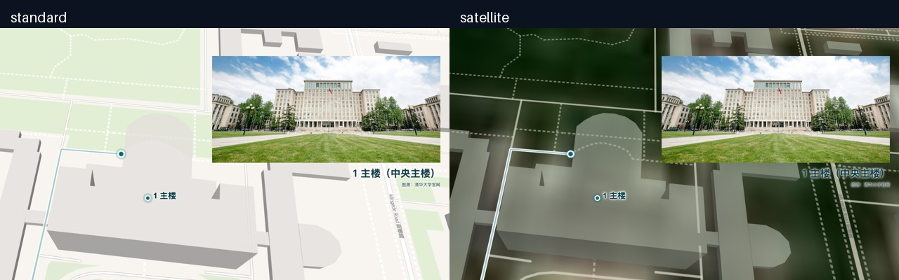

# 清华十二站地图导览

从地球靠近北京，再沿校园道路游览十二处景点。项目保存 V5 开放卫星星空成片、照片、配音、路线和制作工具；可以切换普通矢量底图重新捕获，使用同一套镜头、照片与旁白。

**直接观看：**[V5 卫星星空版 MP4](final/tsinghua-v5-satellite-stars.mp4)。观看已有成片不需要安装开发环境。

| 成片基线 | 内容 |
| --- | --- |
| 画面 | 1280×720，24 fps，8525 帧 |
| 视频时长 | 355.208333 秒 |
| 内容 | 12 站、12 张景点照片、15 段旁白、34 字对联 |
| 配音 | `zh-CN-XiaoxiaoNeural`；friendly、gentle、poetry-reading |
| 路线 | 约 4.62 km，沿路网连贯串联，不声称全局最短或实时可通行 |
| 开场 | 前快后慢的 17 秒聚焦镜头；旁白保持原速 |

## 普通地图和卫星地图怎么切换

`--basemap` 只选择底图模式，不会另换旁白或景点。默认是 `satellite`；明确传 `standard` 即可切换普通地图。**两种模式默认都使用 `stars.svg` 星空背景。**历史版本的白底是背景设计，不是普通地图的数据要求。

| 参数 | 底图与辅助层 | 样式文件 |
| --- | --- | --- |
| `satellite`（默认） | EOxCloudless 2025 卫星拼接影像，叠加 OSM 道路、地名和楼块辅助 | `styles/satellite.json` |
| `standard` | OpenFreeMap 提供的 OpenMapTiles / OpenStreetMap 矢量底图 | `styles/standard.json` |



卫星源来自 Sentinel-2，约 10 米源分辨率。校园近景的道路和楼块辅助来自矢量地图，不能当作卫星照片中的高清屋顶、真实建筑立面或实时画面。最终版不使用 Esri。星空是固定种子的装饰 SVG，不是天文学星图。

### 安装

在仓库根目录进入项目：

```sh
cd projects/tsinghua-tour
npm ci
python3 -m pip install -r requirements.txt
```

还需 Node.js 22+、Python 3.11+、FFmpeg（含 `ffprobe`）和可运行 WebGL 的 Chrome、Edge 或 Chromium。自动查找浏览器失败时，用环境变量 `CHROME_PATH` 指向本机浏览器可执行文件。命令使用 Python、Node 与跨平台 CLI；实际制作环境为 macOS，Linux / Windows 仍需各自验证浏览器启动与字体渲染。Windows 如仅提供 `python` 命令，将示例中的 `python3` 换成相应解释器命令。

首次安装需要网络。预览及逐帧捕获也会请求在线瓦片、地图字体和 sprite；本地 `campus.osm` 是路线数据快照，不能替代地图瓦片服务。本项目不要求 GPU 计算服务或 DSX，但仍需要真实浏览器渲染环境。

### 先预览，再捕获和导出

卫星版：

```sh
npm run preview -- --basemap satellite
npm run capture -- --basemap satellite
python3 tools/export.py --basemap satellite
```

普通地图版：

```sh
npm run preview -- --basemap standard
npm run capture -- --basemap standard
python3 tools/export.py --basemap standard
```

预览用于检查抽样画面，不代替完整捕获。省略 `--basemap` 等同选择卫星版。捕获和导出必须选择同一个模式；缓存与新产物按 `output/satellite/`、`output/standard/` 隔离。导出得到 `output/<模式>/tour.mp4`（聊天播放版）与 `tour-master.mp4`（母片）。保留 `final/` 中的已批准成片，不用试验输出覆盖它。

打开浏览器检查页（镜头由脚本控制，不是自由拖拽地图）：

```sh
npm run serve -- --basemap standard
```

使用终端打印的本地地址。该页面可通过 `?basemap=standard` 或 `?basemap=satellite` 选择底图；命令行参数和查询参数应保持一致。在浏览器开发者控制台执行 `window.setTime(30)` 可检查第30秒画面。检查页不自动播放旁白，声音在导出时拼入；不要用 `file://` 直接打开页面。

捕获支持分段与独立输出目录：

```sh
npm run capture -- --basemap satellite --from 0 --to 408 --out output/satellite/intro-check
```

`--from` 包含起点，`--to` 不包含终点；上述 `0..408` 共408帧，即17秒。分段示例用于检查开场，不能当作完整成片的输入。长任务按顺序捕获；中断后先确认旧进程已退出，再恢复缺失帧，避免同时运行多个浏览器捕获任务。修改样式、时序、素材或视口后，不复用旧指纹的缓存。

## 路线与文件

路线顺序为：新主楼 → 舜德楼 → 二校门 → 日晷 → 清华学堂 → 大礼堂 → 水木清华 → 工字厅 → 近春园 → 西体育馆 → 老图书馆 → 紫荆园食堂。

原八站全部保留，新增新主楼、西体育馆、老图书馆与紫荆园食堂。这里的“新主楼”是用户指定的清华主楼别名，不指其他学校的同名建筑。完整路径、道路节点、景点坐标与吸附距离以 [`route.json`](route.json) 为准；景点位置与道路停留点是两种不同坐标。

| 文件 / 目录 | 用途 |
| --- | --- |
| `route.json`、`campus.osm` | WGS84 路线与 OSM 路网快照；坐标顺序为经度、纬度 |
| `timing.json`、`intro-remap.json` | 帧级镜头、配音位置、对联字时序；开场精确映射共 409 项 |
| `narration.json`、`audio/` | 旁白文本、15 段 WAV / SSML / 边界 JSON、批准版 AAC 音轨 |
| `photos/`、`assets-manifest.json` | 核心景点照片及素材清单 |
| `fonts/`、`stars.svg`、`styles/` | 书法字体与许可、星空、两种地图样式 |
| `final/` | 已批准的 V5 卫星星空成片 |
| `evidence/` | 随成片归档的验收记录与截图；不代表当前机器已重跑 |
| `output/<basemap>/` | 本机生成的预览、帧缓存与导出产物 |

## 验证

```sh
npm test
python3 -m unittest discover -s tests -v
python3 tools/verify.py --video final/tsinghua-v5-satellite-stars.mp4
```

以上是验收入口，不是“全部测试已通过”的声明。修改后必须保留实际命令输出；验证新导出时，把 `--video` 改为本次实际产物路径。除了自动检查，还要看编码后帧、听完各段旁白，确认地图加载、照片对应、对联字序、预约提醒与片尾完整。

本次归档的在线验证与限制见 [`evidence/packaging-checks.json`](evidence/packaging-checks.json)：两种底图的21个关键帧预览成功；此前迁移快照的48帧短片通过。最后复测连续捕获时遇到瓦片等待超时，部分待完成 URL 的独立 HTTP 请求返回403/1010，因此未把该次连续捕获记为通过。遇到403/429或等待超时应保留报告和已验证帧、停止重复请求，待图源恢复正常访问后再续跑，不能拿旧模式图片凑数。已归档 MP4 的离线观看不受影响。

完整可读旁白见 [SCRIPT.md](docs/SCRIPT.md)。制作细节见 [PRODUCTION.md](docs/PRODUCTION.md)，配音与重配流程见 [VOICEOVER.md](docs/VOICEOVER.md)，可复用代理流程见 [campus-map-video skill](skills/campus-map-video/SKILL.md)。默认直接使用已有音频，不调用 Azure；只有明确重新合成才需要 Speech 凭据。

## 来源与使用边界

[来源清单](docs/SOURCES.md) 记录地图、照片、对联和字体出处。EOxCloudless 2025 采用 CC BY-NC-SA 4.0，本版地图改编部分沿用该许可。字体及不同照片分别遵守各自条款，部分照片尚无公开或商业使用授权。私有仓库中的核心素材整理不构成对第三方图片的重新授权，也不意味着整部视频都采用同一许可。公开发布或商用前须另行审核素材权限与画面署名；现有家庭自用版本的处理不能直接套用到公开版本。

旁白保留原提醒：实际游览请提前确认入校预约，并遵守校园现场的开放与通行安排；食堂的访客用餐方式也请提前向校方确认。视频与路网快照不能证明当天可以入校、通行或用餐。
